<div align="center">

# Embedded Firmware Update & Fault Injection Lab

### Validating firmware-update integrity, failure recovery and safe state transitions in C++17

[](https://github.com/Joun-Mikhail/embedded-firmware-update-lab/actions/workflows/ci.yml)


**[Protocol](docs/protocol_specification.md)** ·
**[Receiver](src/receiver.cpp)** ·
**[Decoder](src/packet.cpp)** ·
**[CRC-32](src/crc32.cpp)** ·
**[Fault injection](src/fault_injection.cpp)** ·
**[Tests](docs/test_plan.md)** ·
**[CI](.github/workflows/ci.yml)** ·
**[Limitations](docs/limitations.md)**

</div>

---

## Overview

Devices receive firmware updates in pieces, and a damaged, incomplete or out-of-order update
must never replace working firmware. This project is a **C++17 model of a device receiving an
update**: a documented binary packet protocol, a CRC-32 check on every packet and on the whole
image, and a state machine that installs the new image in a single step only after every check
has passed. Fault-injection tests then corrupt, cut, drop, repeat and reorder packets and
confirm that the previously installed firmware stays byte-for-byte unchanged.

> 🟢 **Valid update →** every packet checked, whole image verified, installed in one step.<br>
> 🔴 **Corrupted update →** rejected; the installed firmware and version are left untouched.

### Scope at a glance

| ✅ What it is | ⛔ What it is not |
|---|---|
| A hardware-independent simulation that runs as a normal program on Linux or Windows | Firmware running on a microcontroller, or a bootloader |
| A binary packet protocol with a documented wire format and a strict decoder | A transport layer (UART, CAN, USB, network) |
| An update state machine with an in-memory "installed image" that is checked by tests | A model of flash memory or of power loss during an update |
| CRC-32 integrity checks that detect **accidental** corruption | Cryptographic authentication or secure boot — a CRC can be recomputed by anyone |

## See it run

<p align="center">
  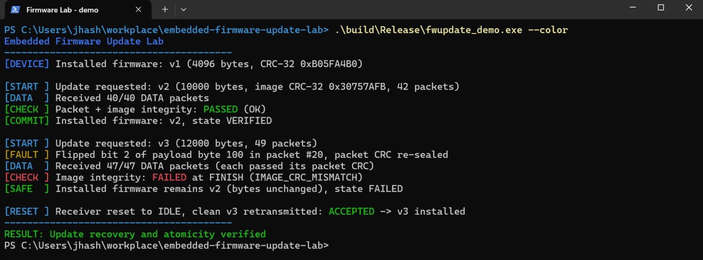
  <br><sub><b>The demo</b>: a corrupted update passes every packet check but is caught by the whole-image check, and v2 stays installed.<br>
  Screen capture of a Windows Terminal session on the author's Windows 11 PC (MSVC 19.51, Visual Studio Build Tools 2026), 23 Nov 2026.</sub>
</p>

<details>
<summary><b>More from the same Windows PC:</b> test run (38/38) and build</summary>
<p align="center">
  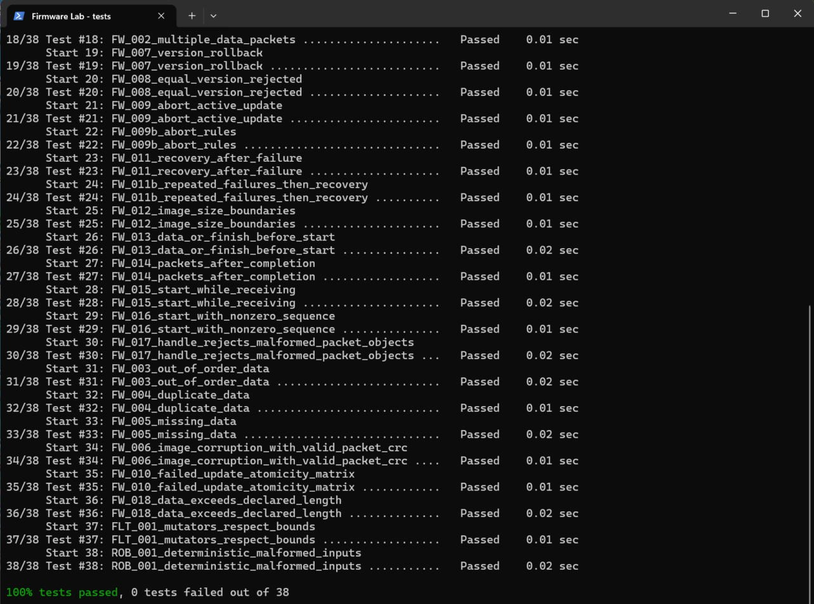
  <br><sub><code>ctest -C Release</code>: <b>100% tests passed, 0 failed out of 38</b> (screen capture).</sub>
</p>
<p align="center">
  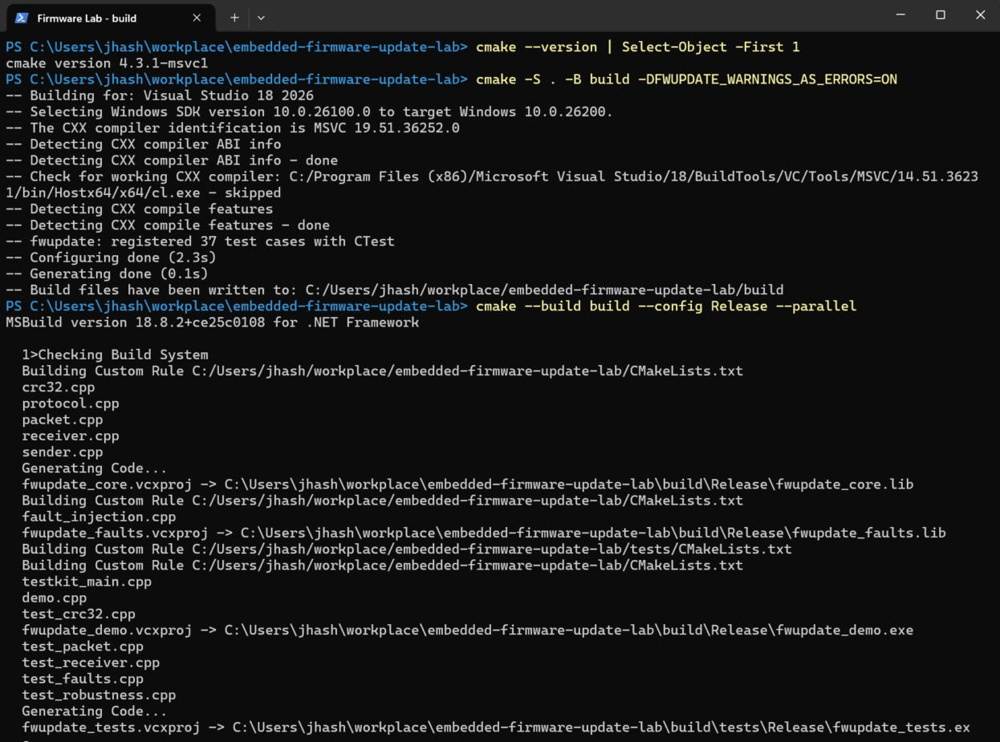
  <br><sub>CMake configures for Visual Studio 2026 / MSVC 19.51 with warnings as errors and builds libraries, demo and tests (screen capture).</sub>
</p>
</details>

<details>
<summary><b>Linux and CI evidence:</b> demo, test and sanitizer runs, GitHub Actions</summary>
<p align="center">
  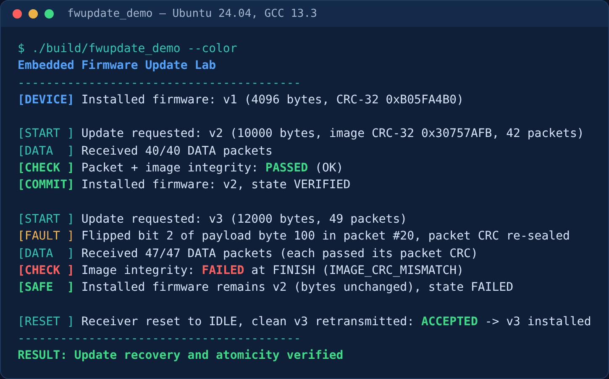
  <br><sub>Demo on Linux (GCC 13.3, Ubuntu 24.04). <i>Image rendered from the recorded terminal log</i> <a href="assets/evidence/demo_output.txt"><code>demo_output.txt</code></a>, not a screen capture.</sub>
</p>
<p align="center">
  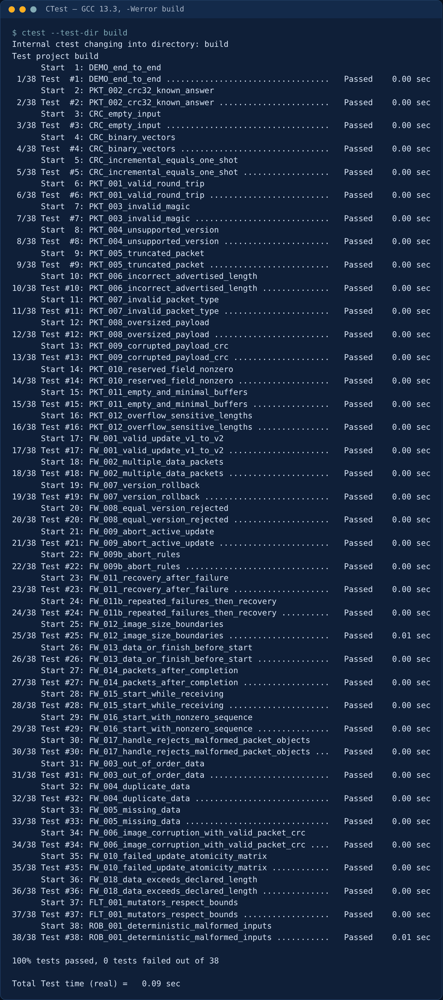
  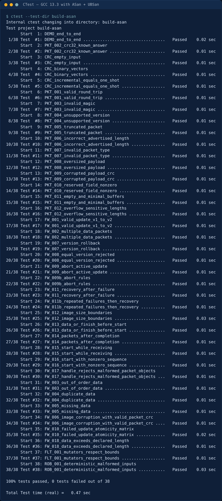
  <br><sub>CTest with GCC 13.3, normal and with ASan + UBSan. <i>Rendered from the recorded logs</i> in <a href="assets/evidence"><code>assets/evidence/</code></a>.</sub>
</p>
<p align="center">
  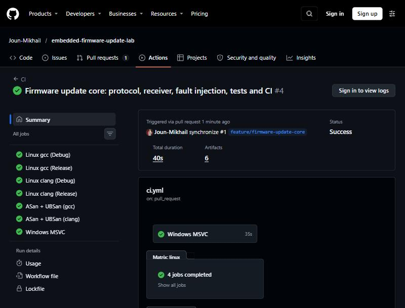
  <br><sub>GitHub Actions, all 7 jobs green. Browser capture of an earlier run (<a href="https://github.com/Joun-Mikhail/embedded-firmware-update-lab/actions/runs/45277523799">#4</a>, commit <code>a43f70d</code>); current status is the CI badge above.</sub>
</p>
</details>

## Results

| | |
|---|---|
| 🧪 **Automated tests** | **38 CTest checks** (37 scenarios + the demo), passing with GCC, Clang and MSVC |
| 💥 **Fault injection** | **15** deterministic mutators: bit flips, CRC corruption, truncation, header tampering, dropped / duplicated / reordered packets, image corruption behind a valid packet CRC |
| 🎲 **Robustness test** | **1 200** malformed inputs from a fixed seed; bounded and reproducible, not a fuzzing campaign |
| 🛡️ **Sanitizers** | AddressSanitizer + UndefinedBehaviorSanitizer: 38/38 passing with no reports on the executed paths (GCC and Clang) |
| 🔁 **Tests can fail** | Two defects planted on purpose were caught: 3 and 2 failing tests ([experiment](docs/regression_experiment.md)) |
| ⚙️ **CI** | **7** GitHub Actions jobs: GCC and Clang × Debug/Release, two sanitizer builds, Windows MSVC, warnings as errors |

## What this project demonstrates

| Skill | Where to look |
|-------|---------------|
| **Low-level C++17**: fixed-width integers, byte-exact big-endian parsing, bounds checked before every read, explicit conversions | [`src/packet.cpp`](src/packet.cpp), [`src/byte_io.hpp`](src/byte_io.hpp) |
| **Protocol design and documentation**: a specification another engineer could implement from | [Protocol specification](docs/protocol_specification.md) |
| **Firmware update logic**: state machine, sequence tracking, version policy, all-or-nothing install | [`src/receiver.cpp`](src/receiver.cpp), [State machine](docs/state_machine.md) |
| **Data integrity**: CRC-32 per packet and over the whole image | [`src/crc32.cpp`](src/crc32.cpp) |
| **Test engineering**: negative tests, boundaries, fault injection, reproducibility | [Test plan](docs/test_plan.md), [`tests/`](tests) |
| **Verification mindset**: sanitizers, warnings as errors, showing that the tests can fail | [Regression experiment](docs/regression_experiment.md) |
| **CI/CD**: cross-platform GitHub Actions pipeline | [`.github/workflows/ci.yml`](.github/workflows/ci.yml) |
| **Honest scoping**: what the project does *not* show | [Limitations](docs/limitations.md) |

## How it works

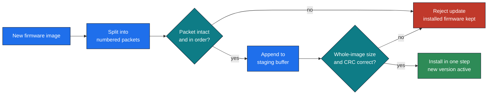

---

# Technical deep dive

*The sections below are for engineers and reviewers.*

## Engineering capabilities

| | |
|---|---|
| **Binary protocol** | Documented big-endian wire format (`FWUP` v1), 14-byte header, 0–256-byte payload, CRC-32 trailer. Strict parsing: lengths are checked before any read, no packed-struct casts, trailing bytes rejected. |
| **Two-level integrity** | CRC-32/ISO-HDLC per packet **and** over the complete image, verified against the `0xCBF43926` known-answer vector. |
| **Update state machine** | `IDLE → RECEIVING → VERIFIED / FAILED`, strict sequence numbers, strictly increasing version policy, explicit `reset()` recovery and ABORT handling. |
| **Atomic commit (in memory)** | Data lands in a staging buffer; image and version change together via a `noexcept` swap only after every check passes. Real flash and power loss are not modelled. |
| **Fault injection** | 15 deterministic mutators: bit flips, CRC corruption, truncation, length/magic/version/type/sequence tampering, drop/duplicate/reorder, and image corruption behind *valid* packet CRCs. |
| **Verification** | 38 CTest tests, warning-clean with `-Wall -Wextra -Wpedantic -Wconversion -Wsign-conversion -Werror`, ASan + UBSan, a seeded 1 200-case robustness test, and a controlled regression experiment. |

## Architecture

```mermaid
flowchart LR
    subgraph S["Sender"]
        A["Firmware image"] --> B["build_update()<br/>START · DATA… · FINISH"] --> C["encode_packet()"]
    end
    subgraph T["Test infrastructure"]
        F["fault:: mutators"]
    end
    subgraph R["Receiver — fwupdate_core"]
        D["decode_packet()<br/>framing · magic · version · length"] --> E["Packet CRC-32<br/>type · reserved · payload rules"]
        E --> G["FirmwareUpdateReceiver<br/>state · sequence · version policy"]
        G --> H["Staging buffer"]
        H -->|"FINISH: size + image CRC ok<br/>atomic swap"| I["Installed firmware slot"]
    end
    C -->|"bytes"| D
    C -.-> F
    F -.->|"malformed packets / streams"| D

    classDef sender fill:#1F6FEB,stroke:#0B1628,color:#ffffff
    classDef recv fill:#0E7C86,stroke:#0B1628,color:#ffffff
    classDef slot fill:#2E8B57,stroke:#0B1628,color:#ffffff
    classDef fault fill:#B7791F,stroke:#0B1628,color:#ffffff
    class A,B,C sender
    class D,E,G,H recv
    class I slot
    class F fault
```

Component responsibilities and design decisions: [docs/architecture.md](docs/architecture.md).

## Binary protocol

<p align="center">
  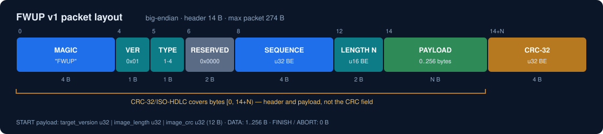
</p>

| Type | Code | Payload | Sequence |
|------|-----:|---------|----------|
| START | `0x01` | target version · image length · image CRC-32 (12 B) | `0` |
| DATA | `0x02` | 1–256 image bytes | `1, 2, 3, …` |
| FINISH | `0x03` | — | last DATA + 1 |
| ABORT | `0x04` | — | next expected |

Full specification, validation order and a byte-exact example:
[docs/protocol_specification.md](docs/protocol_specification.md).

## Update state machine

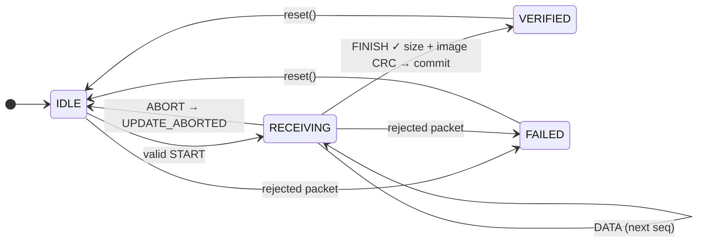

**Invariant:** the installed image and version change together, only at a verified FINISH.
Any rejected packet ends the session in `FAILED` with the previous firmware intact.
Details: [docs/state_machine.md](docs/state_machine.md).

## Valid vs. corrupted update

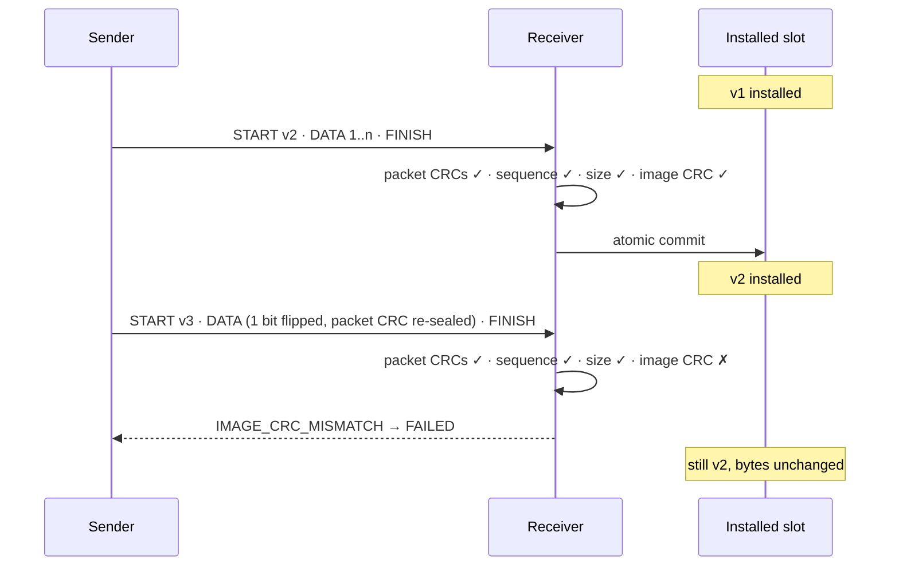

## Fault injection

Every scenario states the valid behaviour, the mutation, the expected rejection, the resulting
state and the preserved firmware. Highlights:

| Mutation | Detected by | Status |
|----------|-------------|--------|
| Single payload bit flip | packet CRC | `CRC_MISMATCH` |
| Packet truncated / length field altered | framing | `INVALID_LENGTH` |
| Magic / version replaced | format check | `INVALID_MAGIC` / `UNSUPPORTED_VERSION` |
| DATA dropped, duplicated or reordered | sequence tracking | `INVALID_SEQUENCE` |
| Last DATA dropped, FINISH renumbered | size check | `IMAGE_INCOMPLETE` |
| **Image byte corrupted, packet CRC re-sealed** | **image CRC only** | `IMAGE_CRC_MISMATCH` |
| Older or equal version | version policy | `VERSION_ROLLBACK` |

```cpp
PacketStream s = *build_update(2, image);
fault::flip_payload_bit(s[4], 17, 3);   // corrupt one image bit
fault::reseal_crc(s[4]);                // ...but keep the packet CRC valid
auto r = feed(receiver, s);             // r.status == Status::ImageCrcMismatch
                                        // receiver.installed_version() == 1
```

Full matrix: [docs/test_plan.md](docs/test_plan.md#fault-injection-matrix).

## Testing and results

| Configuration | Result |
|---------------|--------|
| GCC 13.3, `-Werror` (local) | **38 / 38 passed**, 0 warnings — [log](assets/evidence/ctest_gcc.txt) |
| Clang 18.1, `-Werror` (local) | **38 / 38 passed**, 0 warnings |
| GCC 13.3 + AddressSanitizer + UBSan (local) | **38 / 38 passed**, no reports — [log](assets/evidence/ctest_sanitizers_gcc.txt) |
| MSVC 19.51 (VS Build Tools 2026), Release, `/W4 /WX` (author's Windows 11 PC) | **38 / 38 passed**, demo OK — [screen captures](#see-it-run) |
| GitHub Actions: GCC 13.3 & Clang 18.1 × Debug/Release, ASan+UBSan (GCC & Clang), MSVC 19.44 (VS 2022) `/W4 /WX` | **7 / 7 jobs green, 38 / 38 tests in each** — [workflow runs](https://github.com/Joun-Mikhail/embedded-firmware-update-lab/actions/workflows/ci.yml) |
| Controlled regression experiment | disabling the image CRC → 3 tests fail; accepting equal versions → 2 tests fail — [details](docs/regression_experiment.md) |


## CI pipeline

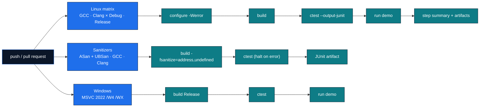

Workflow: [.github/workflows/ci.yml](.github/workflows/ci.yml). Any failing build, test,
sanitizer report or demo expectation fails the job.

## Build and run

Requirements: CMake ≥ 3.16 and a C++17 compiler (GCC, Clang or MSVC). No other dependencies.

**Linux / macOS (Bash)**

```bash
cmake -S . -B build -DFWUPDATE_WARNINGS_AS_ERRORS=ON
cmake --build build --parallel
ctest --test-dir build --output-on-failure
./build/fwupdate_demo --color

# AddressSanitizer + UndefinedBehaviorSanitizer (GCC/Clang)
cmake -S . -B build-asan -DFWUPDATE_ENABLE_SANITIZERS=ON
cmake --build build-asan --parallel
ctest --test-dir build-asan --output-on-failure
```

**Windows (PowerShell, Visual Studio 2022 or 2026 / Build Tools with the C++ workload and a Windows SDK)**

```powershell
# run from a "Developer PowerShell for VS"; CMake picks the newest Visual Studio automatically
cmake -S . -B build -DFWUPDATE_WARNINGS_AS_ERRORS=ON
cmake --build build --config Release --parallel
ctest --test-dir build -C Release --output-on-failure
.\build\Release\fwupdate_demo.exe
```

| CMake option | Default | Effect |
|--------------|---------|--------|
| `FWUPDATE_BUILD_TESTS` | `ON` | Build `fwupdate_tests` and register CTest tests |
| `FWUPDATE_BUILD_DEMO` | `ON` | Build `fwupdate_demo` |
| `FWUPDATE_WARNINGS_AS_ERRORS` | `OFF` | `-Werror` / `/WX` |
| `FWUPDATE_ENABLE_SANITIZERS` | `OFF` | ASan + UBSan on GCC/Clang (ignored with a warning on MSVC) |

## Repository layout

```text
include/fwupdate/   protocol.hpp · crc32.hpp · packet.hpp · receiver.hpp · sender.hpp · fault_injection.hpp
src/                implementation (fwupdate_core + fwupdate_faults)
tests/              self-contained harness and 37 test scenarios (+ demo = 38 CTest checks)
examples/demo.cpp   end-to-end demonstration
docs/               architecture · protocol · state machine · test plan · limitations · regression experiment
assets/             diagrams (SVG + generator), screenshots, recorded evidence logs
```

## Design decisions

- **Explicit result types** — every expected failure is a specific `Status` (16 values); the library does not throw for bad input. Only `std::bad_alloc` from `std::vector` can propagate.
- **Byte-wise big-endian I/O** — portable across hosts, no alignment or aliasing assumptions.
- **Length → CRC → semantics** — fields are read only after bounds are proven and interpreted only after the CRC matches.
- **Fail-closed sessions** — one bad packet ends the update; recovery is an explicit `reset()`.
- **Fault injection outside the core library** — `fwupdate_core` and the demo never link the mutators.
- **Self-contained test harness** — offline builds, each scenario its own CTest test.

More in [docs/architecture.md](docs/architecture.md#design-decisions).

## Limitations

This is a **host-side simulation for learning and validation practice**. It has no real MCU,
flash, bootloader, RTOS or transport layer; the commit is an in-memory swap with no power-loss
guarantee; and **CRC-32 is not authentication** — this is not secure boot or a signed updater.
Sanitizers and tests cover executed paths only. Full list: [docs/limitations.md](docs/limitations.md).

## Documentation

| Document | Contents |
|----------|----------|
| [Architecture](docs/architecture.md) | Components, data flow, design decisions, build targets |
| [Protocol specification](docs/protocol_specification.md) | Wire format, CRC parameters, validation order, receiver rules |
| [State machine](docs/state_machine.md) | States, transitions, lifecycle, atomicity invariant |
| [Test plan](docs/test_plan.md) | Test IDs, expected results, fault-injection matrix, evidence |
| [Regression experiment](docs/regression_experiment.md) | Deliberate defects and the tests that caught them |
| [Limitations](docs/limitations.md) | What this project does not prove |

## License

[MIT](LICENSE) © 2026 Joun Mikhail
