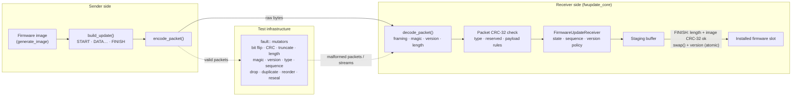

# Architecture

## Components

| # | Component | Where | Responsibility |
|--:|-----------|-------|----------------|
| 1 | Firmware update sender | `sender.hpp/.cpp` — `build_update()`, `build_abort()` | Splits an image into START / DATA… / FINISH, computes the image CRC. |
| 2 | Packet encoder | `packet.cpp` — `encode_packet()` | Serialises a `Packet` to bytes; rejects undefined types and illegal payload sizes, so its output always decodes. |
| 3 | Packet decoder | `packet.cpp` — `decode_packet()` | Parses one untrusted buffer: framing → magic/version → length → CRC → type/reserved/payload rules. |
| 4 | Integrity validator | `crc32.hpp/.cpp` — `Crc32`, `crc32()` | CRC-32/ISO-HDLC used for both packet and image integrity. |
| 5 | Update state machine | `receiver.cpp` — `FirmwareUpdateReceiver` | IDLE / RECEIVING / VERIFIED / FAILED, sequence tracking, version policy. |
| 6 | Staging buffer | `FirmwareUpdateReceiver::staging_` | Collects DATA payloads; never visible as installed firmware. |
| 7 | Installed firmware slot | `installed_image_` + `installed_version_` | Changes only through the atomic commit. |
| 8 | Fault injection | `fault_injection.hpp/.cpp` (`fwupdate_faults` library) | Deterministic byte- and stream-level mutations; not linked into `fwupdate_core`. |
| 9 | Test suite | `tests/` (`fwupdate_tests`) | 37 scenarios, each registered as its own CTest test. |
| 10 | Demo CLI | `examples/demo.cpp` (`fwupdate_demo`) | Runs v1→v2 success, v3 corruption, recovery; exit code reflects the outcome. |

## Data flow

## Design decisions

1. **Free functions for encode/decode.** The codec is stateless, so
   `encode_packet()` / `decode_packet()` are plain functions returning explicit
   result structs (`EncodeResult`, `DecodeResult`) rather than classes or
   exceptions. Every failure carries a specific `Status`.
2. **Byte-wise big-endian I/O.** Fields are assembled with shifts from
   individual bytes (`src/byte_io.hpp`); no `reinterpret_cast`, no packed
   structs, no dependency on host endianness or alignment.
3. **Length before access, CRC before semantics.** The decoder proves the
   buffer is long enough before reading a field, and interprets type /
   reserved / payload rules only after the CRC confirms the header arrived
   intact.
4. **Fail-closed state machine.** Any rejected packet ends the session in
   FAILED; recovery is an explicit `reset()`. This trades convenience for
   predictability: there is no implicit retry logic that could accept a
   half-valid stream.
5. **Commit by swap.** Staging and installed images are separate vectors; the
   commit is a `noexcept` swap plus version assignment, so the installed slot
   is either entirely old or entirely new.
6. **Fault injection outside the core.** Mutators live in a separate library
   (`fwupdate_faults`) that the production code never links against, and
   `reseal_crc()` lets tests deliberately get *past* the packet CRC to reach the
   checks behind it.
7. **Self-contained test harness.** A ~150-line harness (`tests/testkit.*`)
   instead of a fetched framework keeps the build offline-capable. CMake
   registers each `FW_TEST` as an individual CTest test.

## Build targets

| Target | Type | Links |
|--------|------|-------|
| `fwupdate_options` | interface | C++17, warnings, optional sanitizers |
| `fwupdate_core` | static library | `fwupdate_options` |
| `fwupdate_faults` | static library | `fwupdate_core` |
| `fwupdate_demo` | executable | `fwupdate_faults` |
| `fwupdate_tests` | executable | `fwupdate_faults` |
