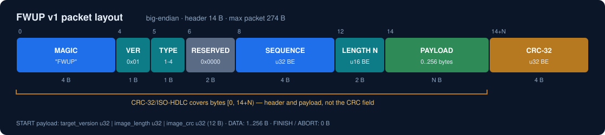

# FWUP v1 — Protocol Specification

This document is the normative description of the wire format implemented in
[`src/packet.cpp`](../src/packet.cpp). Constants live in
[`include/fwupdate/protocol.hpp`](../include/fwupdate/protocol.hpp). A developer
should be able to build a compatible encoder from this page alone.

## 1. Framing

One packet is one self-contained byte buffer. The protocol has no stream
delimiter: the transport is assumed to deliver packet boundaries (as a UART
framing layer, USB bulk transfer, or CAN-TP message would). A buffer must
contain **exactly one packet**; trailing bytes are an error.

All multi-byte integers are **unsigned, big-endian** (most significant byte first),
independent of host byte order. Fields are read byte-by-byte; the
implementation never reinterprets the buffer as a packed C++ structure.

| Offset | Size | Field             | Value / rule                                       |
|-------:|-----:|-------------------|----------------------------------------------------|
| 0      | 4    | Magic             | ASCII `F` `W` `U` `P` (`46 57 55 50`)               |
| 4      | 1    | Protocol version  | `0x01`                                             |
| 5      | 1    | Packet type       | `0x01` START, `0x02` DATA, `0x03` FINISH, `0x04` ABORT |
| 6      | 2    | Reserved          | `0x0000`                                           |
| 8      | 4    | Sequence number   | u32                                                |
| 12     | 2    | Payload length N  | u16, `0 ≤ N ≤ 256`                                 |
| 14     | N    | Payload           | type-specific                                      |
| 14 + N | 4    | Packet CRC-32     | CRC-32/ISO-HDLC over bytes `[0, 14 + N)`           |



| Constant              | Value  |
|-----------------------|-------:|
| Header length         | 14 B   |
| CRC length            | 4 B    |
| Maximum payload       | 256 B  |
| Minimum packet length | 18 B   |
| Maximum packet length | 274 B  |
| Maximum image length  | 65 536 B (64 KiB, simulation limit) |

## 2. CRC-32

Both the per-packet CRC and the complete-image CRC use **CRC-32/ISO-HDLC**
(the CRC used by zlib, Ethernet and PNG):

| Parameter | Value |
|-----------|-------|
| Width     | 32 |
| Polynomial| `0x04C11DB7` (processed in reflected form `0xEDB88320`) |
| Init      | `0xFFFFFFFF` |
| RefIn / RefOut | true / true (LSB-first processing) |
| XorOut    | `0xFFFFFFFF` |
| Check     | CRC of ASCII `123456789` = `0xCBF43926` |
| Empty input | `0x00000000` |

The packet CRC covers the header and the payload and excludes its own four
bytes. It is transmitted big-endian like every other field.

> CRC detects accidental corruption. It is **not** authentication: anyone can
> compute a valid CRC for modified data. See [limitations](limitations.md).

## 3. Packet types and payloads

| Type   | Code | Payload | Sequence number |
|--------|-----:|---------|-----------------|
| START  | 0x01 | exactly 12 bytes (below) | must be `0` |
| DATA   | 0x02 | 1..256 bytes of image data | `1, 2, 3, …` strictly consecutive |
| FINISH | 0x03 | empty | next expected number (last DATA + 1) |
| ABORT  | 0x04 | empty | next expected number |

START payload (big-endian):

| Offset | Size | Field |
|-------:|-----:|-------|
| 0 | 4 | Target firmware version (u32) |
| 4 | 4 | Total image length in bytes (u32), `1 ≤ L ≤ 65 536` |
| 8 | 4 | Expected CRC-32/ISO-HDLC of the complete image |

An empty DATA packet is invalid (it would allow a sequence number to advance
without data). FINISH and ABORT with a payload are invalid.

## 4. Decoder validation order

The decoder (`decode_packet`) checks in this order and reports the **first**
failure. Lengths are checked before any field is read.

| # | Check | Status on failure |
|--:|-------|-------------------|
| 1 | `size ≥ 18` | `INVALID_LENGTH` |
| 2 | Magic = `FWUP` | `INVALID_MAGIC` |
| 3 | Version = 1 | `UNSUPPORTED_VERSION` |
| 4 | Length field `N ≤ 256` | `PAYLOAD_TOO_LARGE` |
| 5 | `size == 14 + N + 4` (truncation or trailing bytes) | `INVALID_LENGTH` |
| 6 | Packet CRC matches | `CRC_MISMATCH` |
| 7 | Type is 1..4 | `INVALID_PACKET_TYPE` |
| 8 | Reserved = 0 | `INVALID_RESERVED` |
| 9 | Payload size legal for the type | `INVALID_PAYLOAD` |

Rationale: magic and version identify the format; the length field is needed
to locate the CRC; the remaining header fields are only interpreted once the
CRC has confirmed they arrived intact. Size arithmetic is done in `size_t`
with `N ≤ 65 535`, so it cannot overflow.

## 5. Receiver rules (session level)

These rules are enforced by `FirmwareUpdateReceiver` after a packet decodes
successfully. See [state_machine.md](state_machine.md) for the transitions.

| Situation | Status |
|-----------|--------|
| START while not IDLE | `INVALID_STATE` |
| START with sequence ≠ 0 | `INVALID_SEQUENCE` |
| START image length = 0 | `INVALID_LENGTH` |
| START image length > 65 536 | `IMAGE_TOO_LARGE` |
| START target version ≤ installed version | `VERSION_ROLLBACK` |
| DATA / FINISH / ABORT while not RECEIVING | `INVALID_STATE` |
| DATA / FINISH / ABORT with unexpected sequence (gap, duplicate, reorder) | `INVALID_SEQUENCE` |
| DATA would exceed the declared image length | `IMAGE_TOO_LARGE` |
| FINISH before all declared bytes arrived | `IMAGE_INCOMPLETE` |
| FINISH and image CRC ≠ declared CRC | `IMAGE_CRC_MISMATCH` |
| ABORT accepted | `UPDATE_ABORTED` (state returns to IDLE) |
| Any packet while VERIFIED or FAILED | `INVALID_STATE` |

**Version policy:** versions must strictly increase. Re-installing the same
version is treated as a rollback.

## 6. Versioning

The version byte identifies the wire format. A receiver implementing v1 rejects
every other value with `UNSUPPORTED_VERSION`; it does not attempt to parse
newer formats. Reserved bits must be zero in v1 so that a future version can
assign them a meaning without being misinterpreted by v1 receivers.

## 7. Worked example

FINISH packet, sequence 7 (18 bytes), as produced by `encode_packet` and
cross-checked with Python's `zlib.crc32`:

```text
46 57 55 50  01  03  00 00  00 00 00 07  00 00  13 5F 45 EF
 magic       ver typ rsvd   sequence     len=0  CRC-32 = 0x135F45EF
```
