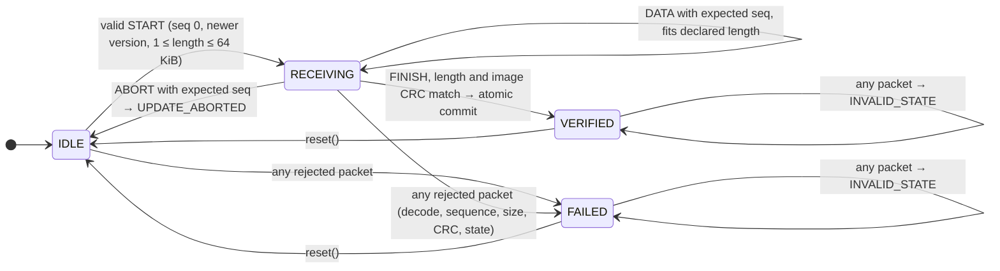
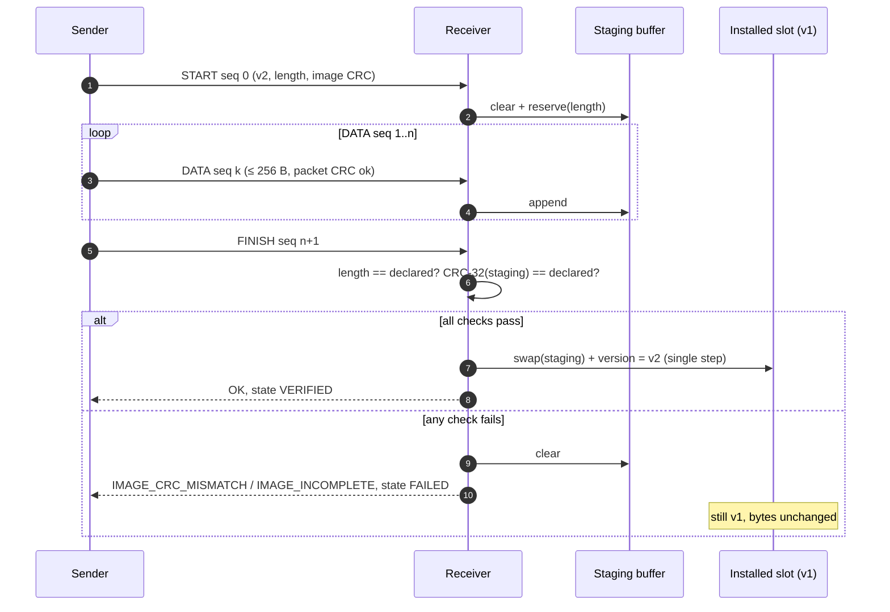

# Update State Machine

Implemented by `FirmwareUpdateReceiver` in
[`src/receiver.cpp`](../src/receiver.cpp). The machine is deterministic: the
next state depends only on the current state and the packet (or `reset()`).

## States and invariants

| State | Meaning | Invariants |
|-------|---------|------------|
| **IDLE** | No update active. | Staging buffer empty. Installed image/version unchanged. Only START is acceptable. |
| **RECEIVING** | START accepted. | `staged_size ≤ declared length`; staging holds exactly the payloads of DATA 1..k in order; `next_sequence = k + 1`; installed image/version unchanged. |
| **VERIFIED** | Last update committed. | Installed image = received image, installed version = target version, staging empty. |
| **FAILED** | Last update rejected. | Staging cleared, nothing committed; installed image/version identical to before the attempt. `last_status()` holds the rejection reason until the next packet is offered (see rule 2). |

## Transition rules

1. **Any rejected packet** in IDLE or RECEIVING (including bytes that fail to
   decode) moves the receiver to **FAILED** and clears the staging buffer. There
   is no "skip this packet and continue" mode: one bad packet ends the session.
   The sender must start again after `reset()`.
2. **VERIFIED and FAILED are terminal** for the session. Every further packet
   is answered with `INVALID_STATE` and does not change anything (the reason
   recorded in FAILED is overwritten in `last_status()` but the state is kept).
3. **`reset()`** returns to IDLE from any state and discards staged data. It
   never touches the installed image or version. Chosen policy: *a subsequent
   update always requires `reset()`*, after success and after failure alike.
4. **ABORT** is a controlled cancel, not a failure: it is only valid in
   RECEIVING, must carry the next expected sequence number (a stale or replayed
   ABORT cannot cancel a newer session), returns `UPDATE_ABORTED`, clears
   staging and goes back to IDLE, so a new START can follow immediately. ABORT
   in any other state is `INVALID_STATE` (→ FAILED from IDLE).

## Update lifecycle (sequence)

## Atomicity invariant

> The installed image and the installed version change **together**, **only**
> in `handle_finish()`, **after** the length and image-CRC checks pass.

Implementation details that enforce it:

- DATA only ever writes into `staging_`; no code path writes to
  `installed_image_` except the commit.
- The commit is `installed_image_.swap(staging_)` (a `noexcept` pointer swap)
  followed by assigning the version, so no partially copied image can exist.
- Every rejection goes through `reject()`, which clears the session but has no
  access path to the installed slot.

The test suite asserts the invariant after packet corruption, CRC mismatch,
invalid sequence, truncation, wrong magic/version/type, length tampering,
image corruption with valid packet CRCs, version rollback and ABORT
(`FW_010_failed_update_atomicity_matrix`), and across 1 200 malformed inputs
(`ROB_001`).

## Limitation of in-memory staging

This is a transaction on RAM objects inside one process. It says nothing about
what happens if power is lost during a flash erase/program cycle, about
flash wear, or about a bootloader choosing between two slots at start-up.
Real devices need A/B slots or a swap/scratch scheme, persistent "pending /
confirmed" flags and a rollback path in the bootloader; none of that is
simulated here. See [limitations.md](limitations.md).
